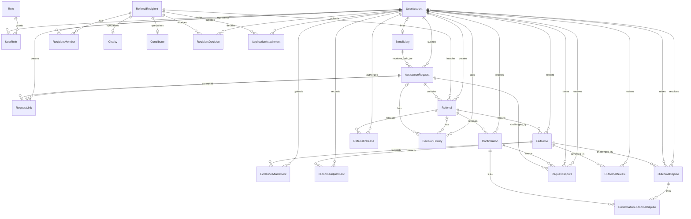

# Proposed conceptual and relational data design

Status: **proposed supporting design, not an existing database or implemented feature**. This design supports the finalized [SRS](SRS.md) and derives from [BRD](BRD.md), especially BR-01–08, BR-10 and BRule-01–14. Field sizes, status codes, storage mechanism and enforcement choices are implementation proposals, not new business approvals. No schema has been applied and no entities have been scaffolded.

## Conceptual EER model

- A **UserAccount** can have zero or more **Roles**, and a role can belong to many users. Beneficiary, third-party requester, administrator and coordinator are involvement/authorization roles; one account may hold several. A beneficiary may represent a person or family, and may exist without a user account. A user may submit many requests. A coordinator is an authorized user, not necessarily a distinct person from an administrator.
- A **ReferralRecipient** specializes into **Charity** or **Contributor**. This specialization is **total and disjoint**: each recipient is exactly one of these subtypes. A charity or contributor has one recipient identity; a user account can represent a recipient through membership. A charity can have multiple representatives, and a person can represent more than one recipient; access still depends on role and involvement. Recipient applications and decisions exist prior to approval; only approved and active recipients are eligible for new referrals.
- A **Beneficiary** has zero or more **AssistanceRequests**; each request has exactly one beneficiary and one submitting account. An account can submit for itself or another person, including a coordinator entering on someone's behalf. A request can be linked to zero or more requests to represent a split; links retain the original, and linked requests are distinct tracked needs. Avoid counting the original and children together as additional need: after a split the original is a non-allocatable parent, with child needs tracked separately.
- A request has zero or more **Referrals**. Each referral belongs to exactly one request and exactly one referral recipient, with a defined quantity or separately trackable scope. Many referrals may exist for one recipient, including historic referrals. A referral has zero or more **Outcomes**, each reported by a representative and reviewed by a coordinator; an outcome has one or more supporting **EvidenceAttachments** before submission. Multiple reports and reviews preserve history. A reported outcome is not independent proof.
- A **DecisionHistory** entry records actor, time, subject, action and rationale when applicable. Request and referral references are typed nullable FKs with exactly one set, rather than a polymorphic unvalidated identifier. Application review history uses a separate RecipientDecision. Beneficiary confirmation or disagreement, if received, is separately recorded; it is not a prerequisite for the course demonstration.

## Relational schema proposal

SQL Server types below are explicit proposals; `!` means NOT NULL, `?` means NULL, PK primary key, FK foreign key, UQ unique. All timestamps are `datetimeoffset(0)` in UTC by application convention. Identifiers are `bigint IDENTITY` unless otherwise stated. Text is Unicode. Foreign keys default to **NO ACTION**, not cascading deletes, preserving history. Authentication details and password lifecycle are an open design decision; no plaintext credentials are modeled. Status fields use the enumerated codes below with CHECK constraints. Request-level authorization and staff access are application-enforced and must also be tested.

| Table | Proposed columns and relationships | Key rules and indexes |
| --- | --- | --- |
| UserAccount | UserId bigint PK; DisplayName nvarchar(200)!; Email nvarchar(320)?; Phone nvarchar(40)?; AccountStatus varchar(20)!; CreatedAt datetimeoffset(0)!; Version rowversion! | Status Pending/Active/Disabled; filtered UQ normalized email if used for login, after identity rules chosen. Contact is not proof of identity. |
| Role | RoleId smallint PK; Code varchar(40)! | UQ Code; initial codes Administrator, Coordinator, Requester, RecipientRepresentative. A user's functional roles may overlap. |
| UserRole | UserId bigint! FK UserAccount; RoleId smallint! FK Role; GrantedAt datetimeoffset(0)! | Composite PK (UserId, RoleId). Role alone never grants unrelated request/evidence access. |
| Beneficiary | BeneficiaryId bigint PK; LinkedUserId bigint? FK UserAccount; DisplayName nvarchar(200)!; ContactDetails nvarchar(500)?; IsFamily bit!; CreatedAt datetimeoffset(0)! | Filtered UQ LinkedUserId when not null is a proposed one-to-one account link; sharing and family representation need validation. |
| ReferralRecipient | RecipientId bigint PK; RecipientType varchar(20)!; DisplayName nvarchar(200)!; ContactDetails nvarchar(500)!; ApprovalStatus varchar(20)!; Active bit!; CreatedAt datetimeoffset(0)!; Version rowversion! | Type Charity/Contributor; status Pending/Approved/Rejected; CHECK Active = 0 unless Approved. Index (ApprovalStatus, Active). Only Approved and Active may receive a new referral. |
| Charity | RecipientId bigint PK/FK ReferralRecipient; RegistrationInformation nvarchar(1000)? | Must supply registration information or supporting application document before review; enforce transactionally. |
| Contributor | RecipientId bigint PK/FK ReferralRecipient | Contact information is on parent. Enforce type/subtype equality, totality and exclusivity in the service transaction or a carefully designed database mechanism; FKs alone cannot enforce them. |
| RecipientMember | RecipientId bigint! FK ReferralRecipient; UserId bigint! FK UserAccount; IsActive bit! | Composite PK (RecipientId, UserId); index (UserId, IsActive). Membership alone does not convey access to unrelated referrals. |
| RecipientDecision | RecipientDecisionId bigint PK; RecipientId bigint! FK ReferralRecipient; ActorUserId bigint! FK UserAccount; Decision varchar(20)!; Reason nvarchar(2000)?; DecidedAt datetimeoffset(0)! | Decision Pending/Approved/Rejected; administrator reviews charities, coordinator reviews contributors. Append only; index (RecipientId, DecidedAt). |
| ApplicationAttachment | ApplicationAttachmentId bigint PK; RecipientId bigint! FK ReferralRecipient; StorageKey nvarchar(500)!; OriginalName nvarchar(255)!; MediaType varchar(150)!; SizeBytes bigint!; UploadedByUserId bigint! FK UserAccount; UploadedAt datetimeoffset(0)! | SizeBytes > 0; UQ StorageKey; restrict access. Registration information or at least one attachment is required for a charity application. |
| AssistanceRequest | RequestId bigint PK; BeneficiaryId bigint! FK Beneficiary; SubmittedByUserId bigint! FK UserAccount; Category varchar(30)?; ServiceSubtype nvarchar(100)?; Description nvarchar(4000)!; RequiredQuantity decimal(18,3)?; Unit nvarchar(50)?; Status varchar(30)!; AuthorityConfirmed bit!; SharingAgreed bit!; CreatedAt datetimeoffset(0)!; Version rowversion! | Category null for unclassified or mixed intake, otherwise Goods/Money/OrganizationalReferral; status Submitted/Clarification/Accepted/Rejected/Open/Completed/ClosedUnresolved/Split. Quantity and unit may be null during intake and on a split parent; allocatable requests require one category, quantity > 0 and a nonblank unit, enforced by transition validation and conditional database constraints. Split-parent identity is structural (an existing parent RequestLink), not inferred solely from Status: a split parent remains non-allocatable even when its status later becomes Completed or ClosedUnresolved. Because a CHECK cannot inspect RequestLink, it must not require category, quantity or unit merely because a request is Completed or ClosedUnresolved; enforce the distinction transactionally or add an explicit immutable split-parent marker with consistency checks. authority and sharing must be true for submission. Money uses an explicit currency as Unit; no cross-currency arithmetic. Service scopes without meaningful quantity use distinct, separately trackable requests with RequiredQuantity=1 and Unit='scope'; this unit is indivisible, so referral, outcome, release and adjustment quantities for it must be whole units (0 or 1 as appropriate). The coordinator defines and reviews distinct scopes to avoid overlap; numeric checks alone cannot establish that scopes do not overlap. This is proposed, not a claim all services are divisible. Index (BeneficiaryId, CreatedAt), (SubmittedByUserId, CreatedAt), (Status, CreatedAt). |
| RequestLink | ParentRequestId bigint! FK AssistanceRequest; ChildRequestId bigint! FK AssistanceRequest; CreatedByUserId bigint! FK UserAccount; CreatedAt datetimeoffset(0)! | Composite PK (ParentRequestId, ChildRequestId); UQ ChildRequestId; parent != child; transactionally prevent cycles and multiple active counting; no allocation to a split parent, including after its terminal status changes. A parent is Split while children are active, then Completed only when all child needs are fulfilled and accepted, or ClosedUnresolved with a reason when work stops with unmet child need; children remain independently tracked and the parent is not included in allocation totals. |
| Referral | ReferralId bigint PK; RequestId bigint! FK AssistanceRequest; RecipientId bigint! FK ReferralRecipient; AssignedQuantity decimal(18,3)!; ScopeDescription nvarchar(2000)!; Status varchar(30)!; CreatedByUserId bigint! FK UserAccount; CreatedAt datetimeoffset(0)!; Version rowversion! | Quantity > 0; status Assigned/PartiallyFulfilled/Completed/Released/Declined/Unresolved; index (RequestId, ReferralId), (RecipientId, Status). An assigned quantity is immutable; accepted quantities and explicit releases are derived from history. |
| Outcome | OutcomeId bigint PK; ReferralId bigint! FK Referral; ReportedByUserId bigint! FK UserAccount; ReportedQuantity decimal(18,3)!; Description nvarchar(4000)!; Status varchar(30)!; SubmittedAt datetimeoffset(0)?; Version rowversion! | Quantity > 0; status Draft/Submitted/Clarification/Accepted/Unresolved. Submission requires at least one attachment, description addressing delivery and receipt, and amount for money; enforce in transaction. Index (ReferralId, Status). Accepted amounts are immutable; correction requires an audited compensating adjustment; accepted reports and reviews remain immutable. |
| EvidenceAttachment | EvidenceId bigint PK; OutcomeId bigint! FK Outcome; StorageKey nvarchar(500)!; OriginalName nvarchar(255)!; MediaType varchar(150)!; SizeBytes bigint!; UploadedByUserId bigint! FK UserAccount; UploadedAt datetimeoffset(0)! | SizeBytes > 0; UQ StorageKey; index (OutcomeId). Metadata is not proof of delivery, receipt, safety or independent verification. |
| OutcomeReview | ReviewId bigint PK; OutcomeId bigint! FK Outcome; ActorUserId bigint! FK UserAccount; Decision varchar(30)!; Reason nvarchar(2000)?; ReviewedAt datetimeoffset(0)! | Decision Accepted/Clarification/Unresolved; append only; coordinator authorization required. Acceptance counted exactly once per outcome; index (OutcomeId, ReviewedAt). |
| OutcomeAdjustment | AdjustmentId bigint PK; OutcomeId bigint! FK Outcome; QuantityDelta decimal(18,3)!; Reason nvarchar(2000)!; ActorUserId bigint! FK UserAccount; CreatedAt datetimeoffset(0)! | Nonzero signed delta; append only. Coordinator authorization required; corrected accepted amount must remain between zero and the originally accepted amount. Index (OutcomeId). Transactionally recheck all referral and request balances. |
| ReferralRelease | ReleaseId bigint PK; ReferralId bigint! FK Referral; ReleasedQuantity decimal(18,3)!; Reason nvarchar(2000)!; ActorUserId bigint! FK UserAccount; ReleasedAt datetimeoffset(0)! | Quantity > 0. Index (ReferralId). Explicit release must never exceed the referral's assigned, unfulfilled and unreleased balance. |
| OutcomeDispute | DisputeId bigint PK; OutcomeId bigint! FK Outcome; RaisedByUserId bigint! FK UserAccount; Details nvarchar(2000)!; RaisedAt datetimeoffset(0)!; ResolvedByUserId bigint? FK UserAccount; Resolution nvarchar(2000)?; ResolvedAt datetimeoffset(0)? | Resolution fields are either all null or all present; one open dispute per outcome enforced by filtered unique index. Retain dispute, source confirmation when applicable, resolution and history; correction uses OutcomeAdjustment. A source confirmation can be associated with an existing open dispute for the same outcome through a separate link table if multiple disagreements are received. |
| ConfirmationOutcomeDispute | ConfirmationId bigint! FK Confirmation; DisputeId bigint! FK OutcomeDispute | Composite PK (ConfirmationId, DisputeId); retain links when several disagreements concern the same outcome. Each disagreement must link to the appropriate outcome dispute or an open request dispute. Transactionally require Confirmation.ReferralId to equal the disputed Outcome.ReferralId; reject cross-referral links. |
| RequestDispute | RequestDisputeId bigint PK; RequestId bigint! FK AssistanceRequest; ConfirmationId bigint! FK Confirmation; Details nvarchar(2000)!; RaisedByUserId bigint! FK UserAccount; RaisedAt datetimeoffset(0)!; ResolvedByUserId bigint? FK UserAccount; Resolution nvarchar(2000)?; ResolvedAt datetimeoffset(0)? | Used when a recorded referral-level disagreement cannot yet be attributed to a specific outcome. Resolution fields are either all null or all present. Retain the source confirmation and resolution; the source Confirmation referral must belong to this RequestId; reject cross-request links transactionally. The open dispute freezes the entire request. If attributed to an outcome, create or link the OutcomeDispute and resolve this row in the same serialized transaction without a gap in the freeze. |
| Confirmation | ConfirmationId bigint PK; ReferralId bigint! FK Referral; RecordedByUserId bigint! FK UserAccount; SourceDescription nvarchar(300)!; Kind varchar(20)!; Details nvarchar(2000)!; RecordedAt datetimeoffset(0)! | Kind Confirmation/Disagreement; optional and separate from coordinator review. Disagreements and insufficient evidence require follow-up. Recording a disagreement must atomically create or associate an open OutcomeDispute when the affected outcome is identified; if it is not identified, create a request-level dispute and freeze the request pending identification or resolution. The source record and dispute remain linked. |
| DecisionHistory | DecisionId bigint PK; RequestId bigint? FK AssistanceRequest; ReferralId bigint? FK Referral; ActorUserId bigint! FK UserAccount; Action varchar(50)!; Reason nvarchar(2000)?; OccurredAt datetimeoffset(0)! | CHECK exactly one subject FK is non-null; index each subject with OccurredAt. Request/referral changes and corresponding history entries commit atomically. Rejection and closed-unresolved require reasons. |

The tables above are a design, not executable DDL. `rowversion` detects stale edits but does not alone prevent over-allocation. Authorization, cross-row totals, subtype exclusivity, evidence counts, state transitions and split-cycle prevention require transactional application logic and/or additional database enforcement. `CHECK` constraints do not validate sums across rows. Actual status transitions, file retention, identity, permissions, and case-insensitive email normalization remain design decisions to validate.

## Proposed relational schema diagram

The diagram shows foreign-key relationships; optionality and business constraints beyond foreign keys are described in the table above. It is a design illustration, not a generated schema.

The two subtype relationships together are total and disjoint, which the diagram alone cannot enforce. For DecisionHistory exactly one of its optional request and referral foreign keys must be present. A child request has at most one parent link. Every submitted outcome requires at least one attachment through transactional validation, although drafts may have none. A declined referral remains unresolved until its unfulfilled amount is explicitly released or otherwise addressed; declining does not silently free it for reassignment.

## Explicit proposed CHECK domains

Each code column below is NOT NULL except nullable AssistanceRequest.Category, and has a CHECK constraint permitting exactly the listed non-null values. Role.Code is an extensible role catalog with the listed initial values rather than a fixed CHECK domain. `bit` columns are non-null unless declared optional; SQL Server bit values are 0 or 1. Other CHECK constraints are identified in the table and all cross-row checks remain transactional.

| Column | Allowed values |
| --- | --- |
| UserAccount.AccountStatus | Pending, Active, Disabled |
| ReferralRecipient.RecipientType | Charity, Contributor |
| ReferralRecipient.ApprovalStatus | Pending, Approved, Rejected |
| RecipientDecision.Decision | Pending, Approved, Rejected |
| AssistanceRequest.Category | NULL (unclassified/mixed intake), Goods, Money, OrganizationalReferral |
| AssistanceRequest.Status | Submitted, Clarification, Accepted, Rejected, Open, Completed, ClosedUnresolved, Split |
| Referral.Status | Assigned, PartiallyFulfilled, Completed, Released, Declined, Unresolved |
| Outcome.Status | Draft, Submitted, Clarification, Accepted, Unresolved |
| OutcomeReview.Decision | Accepted, Clarification, Unresolved |
| Confirmation.Kind | Confirmation, Disagreement |

DecisionHistory.Action is a non-null descriptive code; its permitted catalog and transition-to-action mapping are open design decisions, not a claimed fixed CHECK constraint. Relevant authorization and reason requirements are enforced in transactional service logic.
## Allocation and concurrency invariant

For each allocatable request, define `Q = RequiredQuantity`, `F = sum(accepted Outcome.ReportedQuantity + signed OutcomeAdjustment.QuantityDelta)` over its referrals, and for each referral `A = AssignedQuantity`, `f = sum(accepted outcome quantities plus their signed adjustments)`, `r = sum(explicit releases)`. Its still-assigned unresolved amount is `A − f − r`. Then **remaining need = Q − F** and **unassigned need = Q − F − sum(A − f − r)**. Enforce `f + r <= A`, all quantities nonnegative, and unassigned need >= 0. Only unassigned need may be newly assigned. A release is the only way an undelivered assigned amount becomes available again. Multiple reports for the same delivery must not be accepted twice: application review must ensure each accepted outcome represents a distinct quantity. A recorded disagreement and its link to an existing or newly opened outcome dispute, or a request dispute where the outcome is uncertain, must commit atomically under the request lock. An open outcome or request dispute freezes further allocation, acceptance, release and completion transitions for that request, and flags it for coordinator follow-up; an already completed request is reopened or otherwise visibly marked disputed and cannot be represented as currently completed. A disputed child must make every split ancestor visibly disputed and prevent displaying or newly marking any ancestor completed while that dispute remains open. An ancestor previously completed is reopened or otherwise visibly marked disputed. Resolution, correction, child completion or unresolved closure must atomically recompute the affected ancestors from their children, preserve history, and restore a completed display only when all child needs are fulfilled and accepted and no relevant dispute remains open. A coordinator resolves the dispute in the same serialized request transaction, optionally appending a negative adjustment to the accepted outcome and retaining all prior reports, decisions and dispute history. If reducing accepted quantity would make any referral or request balance invalid, block correction until an explicit resolution restores the invariant; do not silently erase or rewrite records. Recompute statuses and balances, record the reason, and only unfreeze after resolution.

Every assignment, acceptance, release, disagreement recording, dispute opening or resolution, adjustment, request quantity change, split and relevant status change must use a single database transaction at SERIALIZABLE isolation. Acquire request-row update locks (`SELECT ... WITH (UPDLOCK, HOLDLOCK) WHERE RequestId = @id`) after the hierarchy lock described below; then read indexed referrals, outcomes and releases, validate current eligibility and balances, write the change and its history, and commit together. Before discovering any request hierarchy, acquire a transaction-owned shared SQL Server application lock on a single documented hierarchy resource using sp_getapplock; all split/link modifications acquire the same resource exclusively before reading or writing links. All paths follow this order: hierarchy application lock, then request-row update locks in ascending RequestId order, then other rows. Holding the shared lock until commit keeps ancestor discovery stable; the exclusive lock serializes structural modifications and cycle checks. For a child change that can affect a split ancestor, discover the affected request and all ancestors while holding the shared lock, then lock all those request rows in ascending order before validating and changing state. Structural changes acquire the exclusive lock before discovery and lock all affected request rows in ascending order, including ancestors and descendants needed for cycle validation. Treat application-lock timeout or failure as a transaction failure; do not upgrade a shared lock to exclusive mid-transaction. This coarse proposal trades concurrency for simple correctness and requires all writers to follow the protocol. All write paths—including administrative or future batch paths—must obey this protocol; restrict direct writes accordingly. A failure rolls back the complete transaction; deadlocks/transient failures must be retried safely as a whole with idempotent operation identifiers or reported for a safe retry. No external calls or file transfers inside the transaction. Serializable locks may block and require careful load testing; test competing assignments and competing acceptance/release operations against a real isolated SQL Server before claiming correctness. `rowversion` additionally surfaces stale user edits.

Example: Q=10, A=6 and B=4. Accepting 3 for A yields F=3, assigned unresolved 3+4=7, remaining=7, unassigned=0. Releasing 3 from A yields assigned unresolved 0+4=4 and unassigned=3. A stays partially fulfilled with its original assignment, outcome and release history; a new referral may assign those 3. A referral is completed only when its entire assigned quantity is accepted, not merely when it has one accepted partial report. An entirely unfulfilled released referral can be Released; a partially fulfilled one retains its partial status with a release recorded. A request completes only when F=Q; a closed-unresolved request records a reason and is not presented as completed.

## State representation

The proposed dispute freeze does not prohibit a coordinator from closing a request unresolved when work stops, with unmet need and a recorded reason. The dispute and history remain visible; that closure is never displayed as completion. Reopening or further action after such closure requires an authorized recorded decision.

The conceptual lifecycle diagrams describe the business view and are not an additional persisted status column. Outcome.Status records the report review lifecycle, while Referral.Status records the overall assigned portion; an accepted partial outcome therefore leaves its referral PartiallyFulfilled. AssistanceRequest.Status records the request lifecycle. An open OutcomeDispute or RequestDispute is a separate persisted flag derived from unresolved dispute rows and takes precedence over a previously completed display; coordinator resolution recomputes request and referral state. Declined or released referrals retain their history, and only an explicit release changes assigned balance.

## Proposed verification scenarios

- Record a disagreement against an accepted outcome and verify its source confirmation and outcome dispute commit together, the request freezes, and a completed request is visibly disputed; a rollback leaves neither change. Resolve with rationale or an audited correction and verify balances and history. No independent confirmation is implied.
- Complete a split parent and child, open a child dispute, and verify the parent and all ancestors no longer display as completed; resolve or correct it and verify ancestor states recompute atomically. Run competing child dispute and ancestor completion transactions against SQL Server and verify neither commits a false completed display; also race hierarchy link changes against ancestor discovery and verify the structure remains stable until the first transaction commits.
- Attempt to link a confirmation to an outcome dispute for a different referral, and to a request dispute for a different request; both must fail without partial records or state changes. Verify valid same-referral and same-request links succeed.
- Record a referral-level disagreement whose affected outcome is unknown; verify an open request dispute freezes the request, then attribute it to an outcome in one transaction without a gap in the freeze. Also test multiple disagreements concerning the same outcome.
- Split a mixed intake with null category and quantity; complete all children and complete the parent, then separately exercise closure unresolved with unmet child need. Verify neither terminal parent requires allocatable fields or accepts referrals, and its children alone contribute to need totals.
- For an indivisible service request with Q=1 and unit `scope`, reject assignments, releases, outcomes or adjustments of 0.5; allow at most one whole assigned scope, subject to the normal release and fulfillment rules. Review separate service requests for overlapping descriptions, since arithmetic cannot prove distinct real-world scopes.

## Evidence and operational handling

Store only opaque storage keys and metadata in SQL; actual files belong in a configured private file store accessible through authorized API checks, never public URLs. Final choice of storage, encryption, scanning, allowed types and sizes, backup/restore, retention and deletion requires security and local operational review. Validate content, limit uploads and filenames, and coordinate database metadata with upload finalization so failed operations do not leave accessible orphan files. Review access based on recipient membership and the particular referral, plus staff role and assignment; apply least-necessary disclosure for requesters. Use fictional files and people for demonstration. No real-world compliance or independent proof is implied.

## Database-first evolution

1. Review the conceptual model, DDL, security and unresolved operational decisions with the team before creating any schema. Track versioned, reviewed SQL scripts as the source of schema changes; apply only to an authorized isolated development database, never an external or production database during this task. Define backup and rollback before future changes.
2. After an actual authorized schema exists, install compatible EF Core tooling, SQL Server provider and design package, then reverse engineer it with `dotnet ef dbcontext scaffold` using a securely supplied connection string. Limit tables as appropriate; do not commit secrets or claim a scaffold exists now.
3. Keep generated context/entities clearly separated from handwritten DTOs, validation and business services; use partial types or configuration extensions where appropriate. Review generated changes and relationships on every re-scaffold; generated files can be overwritten. Do not hand-edit generated code as the authoritative schema or generate from this uncreated proposal.
4. Verify constraints and representative concurrent and permission scenarios against isolated SQL Server, and verify recovery of both database and file store. Establish change and deployment procedures before real use.

References: [SQL Server transaction locking and row versioning](https://learn.microsoft.com/en-us/sql/relational-databases/sql-server-transaction-locking-and-row-versioning-guide?view=sql-server-ver17); [SERIALIZABLE isolation](https://learn.microsoft.com/en-us/sql/t-sql/statements/set-transaction-isolation-level-transact-sql?view=sql-server-ver17); [EF Core reverse engineering](https://learn.microsoft.com/en-us/ef/core/managing-schemas/scaffolding/); [SQL Server EF Core provider](https://learn.microsoft.com/en-us/ef/core/providers/sql-server/).

