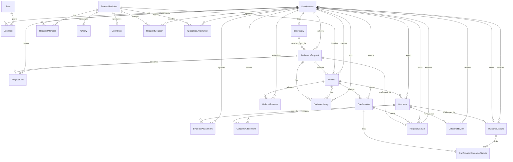

# Confirmed database structure and planned PostgreSQL mapping

Status: **the original core entities and relationships were confirmed by the project owner; this relational design, PostgreSQL enforcement and Phase 1 extensions remain proposals requiring review**. The repository contains EF models and a migration; their presence does not verify applied schema or workflow behavior. Consult the [Phase 1 assessment plan](phase1-assessment-and-reconciliation-plan.md), [roadmap](api-demo-scrum-roadmap.md), [SRS](SRS.md) and [BRD](BRD.md). Field sizes, codes, storage and enforcement choices below are proposals. New Phase 1 changes require reviewed migrations; do not edit already-applied migrations.

## Phase 1 reconciliation and proposed extensions

The original relationships below are retained as the baseline, not a claim that the current database exactly matches this proposal. The latest Phase 1 decision authorizes the **coordinator** to review and approve or reject charity applications, superseding the older administrator-only rule. Administrator and coordinator are distinct roles that may overlap on an account; actor identity, decision time and reason where applicable remain in history. Contributor onboarding and approval are later work. Only approved, active charities are eligible for Phase 1 referrals.

A Phase 1 beneficiary submits their own request containing one or more distinct needs, with authority and sharing confirmations. Third-party and coordinator-on-behalf intake remain full-product scope for later phases. Each need needs its service, recorded standard version, requested quantity, assignments, accepted outcomes and remaining balance; a coordinator may split assignments across eligible charities and issue partial referrals. No parent and child may both add to demand or be allocated twice. The original RequestLink/child-request approach in this document is a candidate to represent these needs, not a confirmed choice for the new demo model. P1-27 must settle its mapping through reviewed design and migrations, with P1-33 implementing the interim exact-version policy for outstanding older-version needs, without discarding the original confirmed relationships.

The demo additionally requires coordinator-managed **versioned service categories and platform unit standards** with structured components (name, quantity and measurement unit); charity-supported services; and per-charity, service and standard-version capacity and Cairo-date update history (P1-12–P1-24). These are proposed extensions, not tables claimed to be present in the baseline below. New requests use current versions, while historical needs, capacities and referrals retain the versions and meaning recorded at the time. P1-33 must implement the interim exact-version rule for outstanding needs until reviewed; no silent conversion or incompatible substitution is permitted, and unmatched needs stay open.

Capacity is nonnegative available-from-now platform units. A daily update replaces current availability and preserves earlier commitments; later assignments deduct availability. At each Africa/Cairo calendar-day boundary, a service/version without an update that day is frozen for new referrals, while a current zero is a valid update with no available units. Existing referrals remain in history. Matching and allocation must check approved active status, supported service, compatible standard version, daily freshness, remaining need and current availability in one consistent transactional decision (P1-18–P1-21, P1-32, P1-34).

Persist a single daily reminder intent per charity with one or more stale services plus attempt outcomes (P1-24–P1-26). Schedule at 08:00 Cairo, support restart and safe retries, and record ambiguous SMTP outcomes; SMTP acceptance is not proof of delivery or exactly-once external delivery. The local email catcher is a demo dependency, not production mail policy.

Private evidence metadata and storage must remain protected by role and referral involvement. An accepted outcome is a coordinator-reviewed report, not independent proof. Count each accepted quantity once; the Phase 1 coordinator may explicitly close a request only after all required needs are fulfilled and accepted. Unresolved closure, confirmation and dispute/correction behavior remain later scope; the dispute rows and algorithms below are proposed and subject to validation, not confirmed requirements or present schema.

P1-53 must review and extend the proposed hierarchy/request locking protocol below with an explicit deterministic lock order for capacity rows shared by both availability updates and referral allocations; test competing writes against isolated PostgreSQL before treating it as safe. Do not add those structures or apply migrations merely by documenting them here.

## Conceptual EER model

- A **UserAccount** can have zero or more **Roles**, and a role can belong to many users. Beneficiary, third-party requester, administrator and coordinator are involvement/authorization roles; one account may hold several. A beneficiary may represent a person or family, and may exist without a user account. A user may submit many requests. A coordinator is an authorized user, not necessarily a distinct person from an administrator.
- A **ReferralRecipient** specializes into **Charity** or **Contributor**. This specialization is **total and disjoint**: each recipient is exactly one of these subtypes. A charity or contributor has one recipient identity; a user account can represent a recipient through membership. A charity can have multiple representatives, and a person can represent more than one recipient; access still depends on role and involvement. Recipient applications and decisions exist prior to approval; only approved and active recipients are eligible for new referrals.
- A **Beneficiary** has zero or more **AssistanceRequests**; each request has exactly one beneficiary and one submitting account. An account can submit for itself or another person, including a coordinator entering on someone's behalf. The earlier design allows requests to be linked to represent a split; links retain the original, and linked requests are distinct tracked needs. The Phase 1 multi-need representation requires review as described above. Avoid counting the original and children together as additional need: after a split the original is a non-allocatable parent, with child needs tracked separately.
- A request has zero or more **Referrals**. Each referral belongs to exactly one request and exactly one referral recipient, with a defined quantity or separately trackable scope. Many referrals may exist for one recipient, including historic referrals. A referral has zero or more **Outcomes**, each reported by a representative and reviewed by a coordinator; an outcome has one or more supporting **EvidenceAttachments** before submission. Multiple reports and reviews preserve history. A reported outcome is not independent proof.
- A **DecisionHistory** entry records actor, time, subject, action and rationale when applicable. Request and referral references are typed nullable FKs with exactly one set, rather than a polymorphic unvalidated identifier. Application review history uses a separate RecipientDecision. Beneficiary confirmation or disagreement, if received, is separately recorded; it is not a prerequisite for the course demonstration.

## Relational schema proposal

PostgreSQL types below are planned mappings; `!` means NOT NULL, `?` means NULL, PK primary key, FK foreign key, UQ unique. Timestamps use `timestamp with time zone`, stored as UTC. Every primary key and corresponding foreign key is UUID; UUIDs are generated by the application. Text is Unicode. Foreign keys default to **NO ACTION**, not cascading deletes, preserving history. Authentication details and password lifecycle are an open design decision; no plaintext credentials are modeled. Status fields use the enumerated codes below with CHECK constraints. Request-level authorization and staff access are application-enforced and must also be tested.

| Table | Proposed columns and relationships | Key rules and indexes |
| --- | --- | --- |
| UserAccount | UserId uuid PK; DisplayName varchar(200)!; Email varchar(320)?; Phone varchar(40)?; AccountStatus varchar(20)!; CreatedAt timestamptz!; Version uuid! | Status Pending/Active/Disabled; partial UQ normalized email if used for login, after identity rules chosen. Contact is not proof of identity. |
| Role | RoleId uuid PK; Code varchar(40)! | UQ Code; initial codes Administrator, Coordinator, Requester, RecipientRepresentative. A user's functional roles may overlap. |
| UserRole | UserRoleId uuid PK; UserId uuid! FK UserAccount; RoleId uuid! FK Role; GrantedAt timestamptz! | UQ (UserId, RoleId). Role alone never grants unrelated request/evidence access. |
| Beneficiary | BeneficiaryId uuid PK; Reference varchar(32)! UQ; CreatedByUserId uuid! FK UserAccount; LinkedUserId uuid? FK UserAccount; DisplayName varchar(200)!; ContactDetails varchar(500)?; IsFamily boolean!; CreatedAt timestamptz! | CreatedByUserId tracks the creator for access before a request exists; partial UQ LinkedUserId when not null remains a proposed one-to-one account link. Sharing and family representation need validation. |
| ReferralRecipient | RecipientId uuid PK; Reference varchar(32)! UQ; RecipientType varchar(20)!; DisplayName varchar(200)!; ContactDetails varchar(500)!; ApprovalStatus varchar(20)!; Active boolean!; CreatedAt timestamptz!; Version uuid! | Type Charity/Contributor; status Pending/Approved/Rejected; CHECK Active = false unless Approved. Index (ApprovalStatus, Active). Only Approved and Active may receive a new referral. |
| Charity | RecipientId uuid PK/FK ReferralRecipient; RegistrationInformation varchar(1000)? | Must supply registration information or supporting application document before review; enforce transactionally. |
| Contributor | RecipientId uuid PK/FK ReferralRecipient | Contact information is on parent. Enforce type/subtype equality, totality and exclusivity in the service transaction or a carefully designed database mechanism; FKs alone cannot enforce them. |
| RecipientMember | RecipientMemberId uuid PK; RecipientId uuid! FK ReferralRecipient; UserId uuid! FK UserAccount; IsActive boolean! | UQ (RecipientId, UserId); index (UserId, IsActive). Membership alone does not convey access to unrelated referrals. |
| RecipientDecision | RecipientDecisionId uuid PK; RecipientId uuid! FK ReferralRecipient; ActorUserId uuid! FK UserAccount; Decision varchar(20)!; Reason varchar(2000)?; DecidedAt timestamptz! | Decision Pending/Approved/Rejected; in Phase 1 coordinator reviews charities; contributor approval remains later scope. Append only; index (RecipientId, DecidedAt). |
| ApplicationAttachment | ApplicationAttachmentId uuid PK; RecipientId uuid! FK ReferralRecipient; StorageKey varchar(500)!; OriginalName varchar(255)!; MediaType varchar(150)!; SizeBytes bigint!; UploadedByUserId uuid! FK UserAccount; UploadedAt timestamptz! | SizeBytes > 0; UQ StorageKey; restrict access. Registration information or at least one attachment is required for a charity application. |
| AssistanceRequest | RequestId uuid PK; Reference varchar(32)! UQ; BeneficiaryId uuid! FK Beneficiary; SubmittedByUserId uuid! FK UserAccount; Category varchar(30)?; ServiceSubtype varchar(100)?; Description varchar(4000)!; RequiredQuantity decimal(18,3)?; Unit varchar(50)?; Status varchar(30)!; AuthorityConfirmed boolean!; SharingAgreed boolean!; CreatedAt timestamptz!; Version uuid! | Category null for unclassified or mixed intake, otherwise Goods/Money/OrganizationalReferral; status Submitted/Clarification/Accepted/Rejected/Open/Completed/ClosedUnresolved/Split. Quantity and unit may be null during intake and on a split parent; allocatable requests require one category, quantity > 0 and a nonblank unit, enforced by transition validation and conditional database constraints. Split-parent identity is structural (an existing parent RequestLink), not inferred solely from Status: a split parent remains non-allocatable even when its status later becomes Completed or ClosedUnresolved. Because a CHECK cannot inspect RequestLink, it must not require category, quantity or unit merely because a request is Completed or ClosedUnresolved; enforce the distinction transactionally or add an explicit immutable split-parent marker with consistency checks. authority and sharing must be true for submission. Money uses an explicit currency as Unit; no cross-currency arithmetic. Service scopes without meaningful quantity use distinct, separately trackable requests with RequiredQuantity=1 and Unit='scope'; this unit is indivisible, so referral, outcome, release and adjustment quantities for it must be whole units (0 or 1 as appropriate). The coordinator defines and reviews distinct scopes to avoid overlap; numeric checks alone cannot establish that scopes do not overlap. This is proposed, not a claim all services are divisible. Index (BeneficiaryId, CreatedAt), (SubmittedByUserId, CreatedAt), (Status, CreatedAt). |
| RequestLink | RequestLinkId uuid PK; ParentRequestId uuid! FK AssistanceRequest; ChildRequestId uuid! FK AssistanceRequest; CreatedByUserId uuid! FK UserAccount; CreatedAt timestamptz! | UQ (ParentRequestId, ChildRequestId); UQ ChildRequestId; parent != child; transactionally prevent cycles and multiple active counting; no allocation to a split parent, including after its terminal status changes. A parent is Split while children are active, then Completed only when all child needs are fulfilled and accepted, or ClosedUnresolved with a reason when work stops with unmet child need; children remain independently tracked and the parent is not included in allocation totals. |
| Referral | ReferralId uuid PK; Reference varchar(32)! UQ; RequestId uuid! FK AssistanceRequest; RecipientId uuid! FK ReferralRecipient; AssignedQuantity decimal(18,3)!; ScopeDescription varchar(2000)!; Status varchar(30)!; CreatedByUserId uuid! FK UserAccount; CreatedAt timestamptz!; Version uuid! | Quantity > 0; status Assigned/PartiallyFulfilled/Completed/Released/Declined/Unresolved; index (RequestId, ReferralId), (RecipientId, Status). An assigned quantity is immutable; accepted quantities and explicit releases are derived from history. |
| Outcome | OutcomeId uuid PK; Reference varchar(32)! UQ; ReferralId uuid! FK Referral; ReportedByUserId uuid! FK UserAccount; ReportedQuantity decimal(18,3)!; Description varchar(4000)!; Status varchar(30)!; SubmittedAt timestamptz?; Version uuid! | Quantity > 0; status Draft/Submitted/Clarification/Accepted/Unresolved. Submission requires at least one attachment, description addressing delivery and receipt, and amount for money; enforce in transaction. Index (ReferralId, Status). Accepted amounts are immutable; correction requires an audited compensating adjustment; accepted reports and reviews remain immutable. |
| EvidenceAttachment | EvidenceId uuid PK; OutcomeId uuid! FK Outcome; StorageKey varchar(500)!; OriginalName varchar(255)!; MediaType varchar(150)!; SizeBytes bigint!; UploadedByUserId uuid! FK UserAccount; UploadedAt timestamptz! | SizeBytes > 0; UQ StorageKey; index (OutcomeId). Metadata is not proof of delivery, receipt, safety or independent verification. |
| OutcomeReview | ReviewId uuid PK; OutcomeId uuid! FK Outcome; ActorUserId uuid! FK UserAccount; Decision varchar(30)!; Reason varchar(2000)?; ReviewedAt timestamptz! | Decision Accepted/Clarification/Unresolved; append only; coordinator authorization required. Acceptance counted exactly once per outcome; index (OutcomeId, ReviewedAt). |
| OutcomeAdjustment | AdjustmentId uuid PK; OutcomeId uuid! FK Outcome; QuantityDelta decimal(18,3)!; Reason varchar(2000)!; ActorUserId uuid! FK UserAccount; CreatedAt timestamptz! | Nonzero signed delta; append only. Coordinator authorization required; corrected accepted amount must remain between zero and the originally accepted amount. Index (OutcomeId). Transactionally recheck all referral and request balances. |
| ReferralRelease | ReleaseId uuid PK; ReferralId uuid! FK Referral; ReleasedQuantity decimal(18,3)!; Reason varchar(2000)!; ActorUserId uuid! FK UserAccount; ReleasedAt timestamptz! | Quantity > 0. Index (ReferralId). Explicit release must never exceed the referral's assigned, unfulfilled and unreleased balance. |
| OutcomeDispute | DisputeId uuid PK; OutcomeId uuid! FK Outcome; RaisedByUserId uuid! FK UserAccount; Details varchar(2000)!; RaisedAt timestamptz!; ResolvedByUserId uuid? FK UserAccount; Resolution varchar(2000)?; ResolvedAt timestamptz? | Resolution fields are either all null or all present; one open dispute per outcome enforced by partial unique index. Retain dispute, source confirmation when applicable, resolution and history; correction uses OutcomeAdjustment. A source confirmation can be associated with an existing open dispute for the same outcome through a separate link table if multiple disagreements are received. |
| ConfirmationOutcomeDispute | ConfirmationOutcomeDisputeId uuid PK; ConfirmationId uuid! FK Confirmation; DisputeId uuid! FK OutcomeDispute | UQ (ConfirmationId, DisputeId); retain links when several disagreements concern the same outcome. Each disagreement must link to the appropriate outcome dispute or an open request dispute. Transactionally require Confirmation.ReferralId to equal the disputed Outcome.ReferralId; reject cross-referral links. |
| RequestDispute | RequestDisputeId uuid PK; RequestId uuid! FK AssistanceRequest; ConfirmationId uuid! FK Confirmation; Details varchar(2000)!; RaisedByUserId uuid! FK UserAccount; RaisedAt timestamptz!; ResolvedByUserId uuid? FK UserAccount; Resolution varchar(2000)?; ResolvedAt timestamptz? | Used when a recorded referral-level disagreement cannot yet be attributed to a specific outcome. Resolution fields are either all null or all present. Retain the source confirmation and resolution; the source Confirmation referral must belong to this RequestId; reject cross-request links transactionally. The open dispute freezes the entire request. If attributed to an outcome, create or link the OutcomeDispute and resolve this row in the same serialized transaction without a gap in the freeze. |
| Confirmation | ConfirmationId uuid PK; ReferralId uuid! FK Referral; RecordedByUserId uuid! FK UserAccount; SourceDescription varchar(300)!; Kind varchar(20)!; Details varchar(2000)!; RecordedAt timestamptz! | Kind Confirmation/Disagreement; optional and separate from coordinator review. Disagreements and insufficient evidence require follow-up. Recording a disagreement must atomically create or associate an open OutcomeDispute when the affected outcome is identified; if it is not identified, create a request-level dispute and freeze the request pending identification or resolution. The source record and dispute remain linked. |
| DecisionHistory | DecisionId uuid PK; RequestId uuid? FK AssistanceRequest; ReferralId uuid? FK Referral; ActorUserId uuid! FK UserAccount; Action varchar(50)!; Reason varchar(2000)?; OccurredAt timestamptz! | CHECK exactly one subject FK is non-null; index each subject with OccurredAt. Request/referral changes and corresponding history entries commit atomically. Rejection and closed-unresolved require reasons. |

The tables above are a design, not executable DDL. An application-managed UUID concurrency token detects stale edits but does not alone prevent over-allocation. Authorization, cross-row totals, subtype exclusivity, evidence counts, state transitions and split-cycle prevention require transactional application logic and/or additional database enforcement. `CHECK` constraints do not validate sums across rows. Actual status transitions, file retention, identity, permissions, and case-insensitive email normalization remain design decisions to validate.

## Proposed relational schema diagram

The diagram shows the earlier proposed relationships; optionality and business constraints beyond foreign keys are described in the table above. Phase 1 service, standard, capacity, reminder and multi-need mapping extensions are not yet represented. This diagram is not a generated or verified schema; P1-27 and P1-53 own the reviewed design updates.

The two subtype relationships together are total and disjoint, which the diagram alone cannot enforce. For DecisionHistory exactly one of its optional request and referral foreign keys must be present. A child request has at most one parent link. Every submitted outcome requires at least one attachment through transactional validation, although drafts may have none. A declined referral remains unresolved until its unfulfilled amount is explicitly released or otherwise addressed; declining does not silently free it for reassignment.

## Explicit proposed CHECK domains

Each code column below is NOT NULL except nullable AssistanceRequest.Category, and has a CHECK constraint permitting exactly the listed non-null values. Role.Code is an extensible role catalog with the listed initial values rather than a fixed CHECK domain. `boolean` columns are non-null unless declared optional. Other CHECK constraints are identified in the table and all cross-row checks remain transactional.

| Column | Allowed values |
| --- | --- |
| UserAccount.AccountStatus | Pending, Active, Disabled |
| ReferralRecipient.RecipientType | Charity, Contributor |
| ReferralRecipient.ApprovalStatus | Pending, Approved, Rejected |
| RecipientDecision.Decision | Pending, Approved, Rejected |
| AssistanceRequest.Category | NULL (unclassified/mixed intake), Goods, Money, OrganizationalReferral |
| AssistanceRequest.Status | Submitted, Clarification, Accepted, Rejected, Open, Completed, ClosedUnresolved, Split |
| Referral.Status | Assigned, PartiallyFulfilled, Completed, Released, Declined, Unresolved |
| Outcome.Status | Draft, Submitted, Clarification, Accepted, Unresolved |
| OutcomeReview.Decision | Accepted, Clarification, Unresolved |
| Confirmation.Kind | Confirmation, Disagreement |

DecisionHistory.Action is a non-null descriptive code; its permitted catalog and transition-to-action mapping are open design decisions, not a claimed fixed CHECK constraint. Relevant authorization and reason requirements are enforced in transactional service logic.
## Allocation and concurrency invariant

The following formula applies to the earlier single-need request representation. A reviewed Phase 1 multi-need mapping must apply equivalent invariants per distinct need and capacity version, without counting parents and children twice. Dispute and correction behavior in this section is a proposed later increment subject to validation, not Phase 1.

For each allocatable request, define `Q = RequiredQuantity`, `F = sum(accepted Outcome.ReportedQuantity + signed OutcomeAdjustment.QuantityDelta)` over its referrals, and for each referral `A = AssignedQuantity`, `f = sum(accepted outcome quantities plus their signed adjustments)`, `r = sum(explicit releases)`. Its still-assigned unresolved amount is `A − f − r`. Then **remaining need = Q − F** and **unassigned need = Q − F − sum(A − f − r)**. Enforce `f + r <= A`, all quantities nonnegative, and unassigned need >= 0. Only unassigned need may be newly assigned. A release is the only way an undelivered assigned amount becomes available again. Multiple reports for the same delivery must not be accepted twice: application review must ensure each accepted outcome represents a distinct quantity. A recorded disagreement and its link to an existing or newly opened outcome dispute, or a request dispute where the outcome is uncertain, must commit atomically under the request lock. An open outcome or request dispute freezes further allocation, acceptance, release and completion transitions for that request, and flags it for coordinator follow-up; an already completed request is reopened or otherwise visibly marked disputed and cannot be represented as currently completed. A disputed child must make every split ancestor visibly disputed and prevent displaying or newly marking any ancestor completed while that dispute remains open. An ancestor previously completed is reopened or otherwise visibly marked disputed. Resolution, correction, child completion or unresolved closure must atomically recompute the affected ancestors from their children, preserve history, and restore a completed display only when all child needs are fulfilled and accepted and no relevant dispute remains open. A coordinator resolves the dispute in the same serialized request transaction, optionally appending a negative adjustment to the accepted outcome and retaining all prior reports, decisions and dispute history. If reducing accepted quantity would make any referral or request balance invalid, block correction until an explicit resolution restores the invariant; do not silently erase or rewrite records. Recompute statuses and balances, record the reason, and only unfreeze after resolution.

Under the proposed protocol, every assignment, acceptance, release, disagreement, dispute resolution, adjustment, quantity change, split and relevant status change runs in one PostgreSQL transaction. P1-53 must also define and verify the ordering of relevant capacity rows for every availability update and allocation writer before implementing this protocol for Phase 1. Before reading the hierarchy, acquire transaction-scoped advisory lock key `726857101` with `pg_advisory_xact_lock_shared` for ordinary operations or `pg_advisory_xact_lock` for structural link changes; never upgrade a shared lock. Discover affected requests while holding that lock, then acquire `SELECT ... FOR UPDATE` locks on their rows one at a time in ascending PostgreSQL UUID order, followed by other rows. Structural changes include ancestors and descendants needed for cycle checks. After all locks are held, read current balances and eligibility, validate, write the change and history, and commit. All writers, including administrative and batch paths, follow this protocol; direct writes must be restricted. Use READ COMMITTED so reads after waiting for locks observe committed changes. Roll back on failure; retry an entire transaction after deadlock or transient failure only with a safe idempotency strategy. Keep external calls and file transfers outside the transaction. Test the protocol against real PostgreSQL, including competing hierarchy changes and allocation operations. Application-managed UUID concurrency tokens additionally detect stale user edits; they do not replace locks.

Example: Q=10, A=6 and B=4. Accepting 3 for A yields F=3, assigned unresolved 3+4=7, remaining=7, unassigned=0. Releasing 3 from A yields assigned unresolved 0+4=4 and unassigned=3. A stays partially fulfilled with its original assignment, outcome and release history; a new referral may assign those 3. A referral is completed only when its entire assigned quantity is accepted, not merely when it has one accepted partial report. An entirely unfulfilled released referral can be Released; a partially fulfilled one retains its partial status with a release recorded. A request completes only when F=Q; a closed-unresolved request records a reason and is not presented as completed.

## State representation

In the later proposed dispute increment, a dispute freeze would not prohibit a coordinator from closing a request unresolved when work stops, with unmet need and a recorded reason. Phase 1 completion instead requires explicit closure only after every required need is fulfilled and accepted. The dispute and history remain visible; that closure is never displayed as completion. Reopening or further action after such closure requires an authorized recorded decision.

The conceptual lifecycle diagrams describe the business view and are not an additional persisted status column. Outcome.Status records the report review lifecycle, while Referral.Status records the overall assigned portion; an accepted partial outcome therefore leaves its referral PartiallyFulfilled. AssistanceRequest.Status records the request lifecycle. An open OutcomeDispute or RequestDispute is a separate persisted flag derived from unresolved dispute rows and takes precedence over a previously completed display; coordinator resolution recomputes request and referral state. Declined or released referrals retain their history, and only an explicit release changes assigned balance.

## Proposed verification scenarios

Phase 1 scenarios, not yet test results: verify self-only submission, coordinator approval and unrelated-user denial; immutable historical service/standard versions and the interim exact-version P1-33 policy; Cairo-day stale versus current-zero capacity; one daily reminder intent and safe retry handling; concurrent allocation versus availability updates on isolated PostgreSQL; partial split portions with no double counting; evidence access and explicit closure only after all needs are fulfilled and accepted.

The following dispute and correction scenarios are **later proposals subject to validation**, outside the Phase 1 demonstration:

- Record a disagreement against an accepted outcome and verify its source confirmation and outcome dispute commit together, the request freezes, and a completed request is visibly disputed; a rollback leaves neither change. Resolve with rationale or an audited correction and verify balances and history. No independent confirmation is implied.
- Complete a split parent and child, open a child dispute, and verify the parent and all ancestors no longer display as completed; resolve or correct it and verify ancestor states recompute atomically. Run competing child dispute and ancestor completion transactions against PostgreSQL and verify neither commits a false completed display; also race hierarchy link changes against ancestor discovery and verify the structure remains stable until the first transaction commits.
- Attempt to link a confirmation to an outcome dispute for a different referral, and to a request dispute for a different request; both must fail without partial records or state changes. Verify valid same-referral and same-request links succeed.
- Record a referral-level disagreement whose affected outcome is unknown; verify an open request dispute freezes the request, then attribute it to an outcome in one transaction without a gap in the freeze. Also test multiple disagreements concerning the same outcome.
- Split a mixed intake with null category and quantity; complete all children and complete the parent, then separately exercise closure unresolved with unmet child need. Verify neither terminal parent requires allocatable fields or accepts referrals, and its children alone contribute to need totals.
- For an indivisible service request with Q=1 and unit `scope`, reject assignments, releases, outcomes or adjustments of 0.5; allow at most one whole assigned scope, subject to the normal release and fulfillment rules. Review separate service requests for overlapping descriptions, since arithmetic cannot prove distinct real-world scopes.

## Evidence and operational handling

Store only opaque storage keys and metadata in PostgreSQL; actual files belong in a configured private file store accessible through authorized API checks, never public URLs. Final choice of storage, encryption, scanning, allowed types and sizes, backup/restore, retention and deletion requires security and local operational review. Validate content, limit uploads and filenames, and coordinate database metadata with upload finalization so failed operations do not leave accessible orphan files. Review access based on recipient membership and the particular referral, plus staff role and assignment; apply least-necessary disclosure for requesters. Use fictional files and people for demonstration. No real-world compliance or independent proof is implied.

## Code-first evolution

1. Map the confirmed structure and constraints in EF Core using the Npgsql provider. Review the initial migration and generated SQL before applying it to an isolated local PostgreSQL database.
2. For every later schema change, update the model, generate a named migration, review both directions and generated SQL, and commit the migration and model snapshot with the change. Never edit an already-applied migration; add a corrective migration instead.
3. Apply reviewed migrations as a controlled deployment step with a backup and recovery plan. Do not automatically migrate on application startup in shared or production environments. Restore-test PostgreSQL and private evidence together.
4. Run migration-from-empty and upgrade tests, plus PostgreSQL integration tests for constraints, access and concurrency. See the [API v1 plan](api-v1-plan.md) for local commands and reference allocation.

References: [PostgreSQL explicit locking](https://www.postgresql.org/docs/current/explicit-locking.html); [PostgreSQL transaction isolation](https://www.postgresql.org/docs/current/transaction-iso.html); [EF Core migrations](https://learn.microsoft.com/en-us/ef/core/managing-schemas/migrations/); [Npgsql EF Core provider](https://www.npgsql.org/efcore/).
