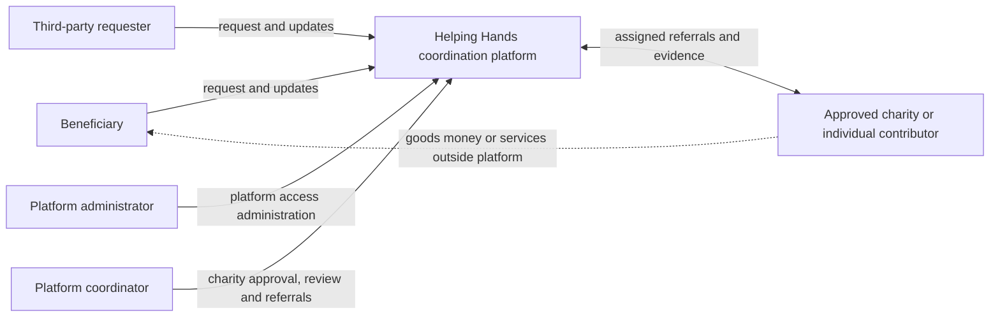
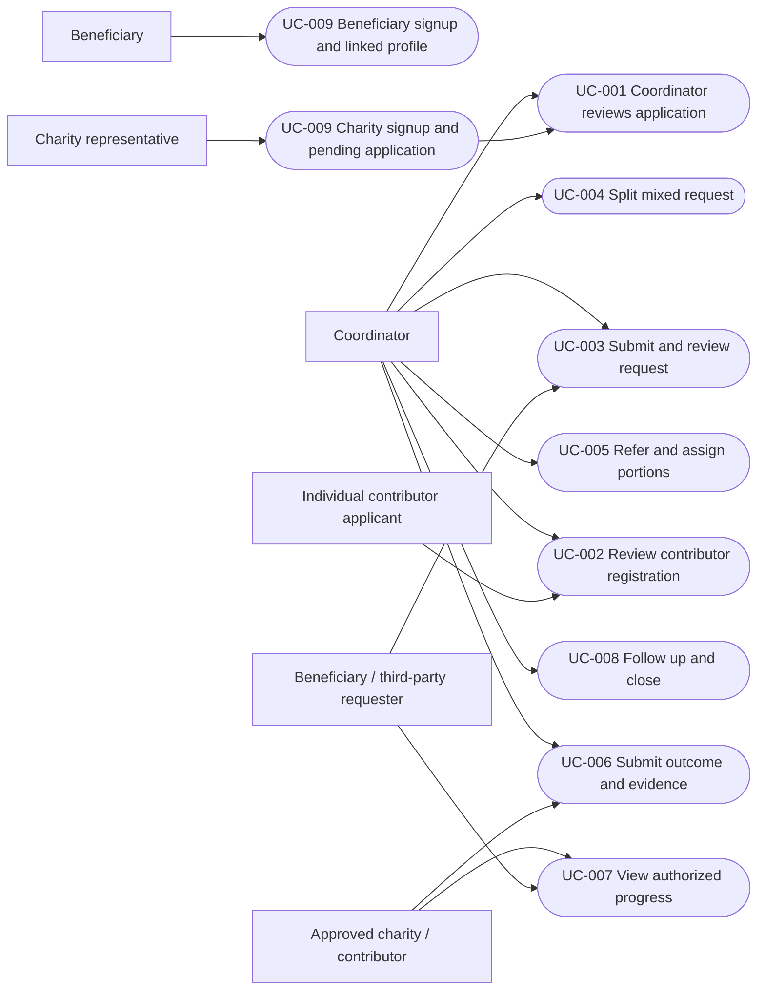
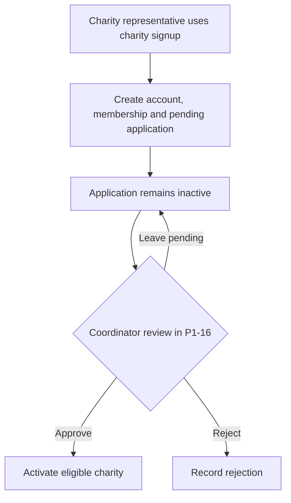
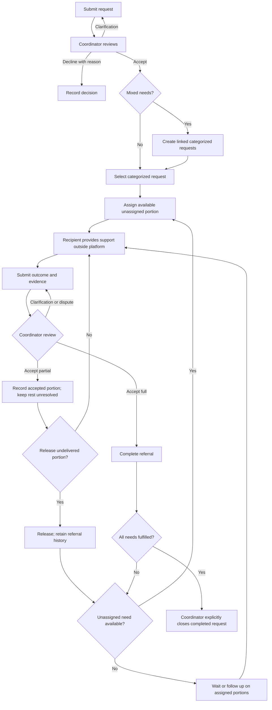
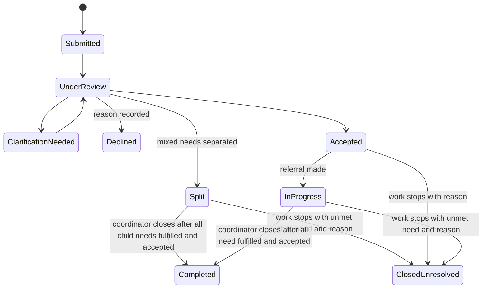
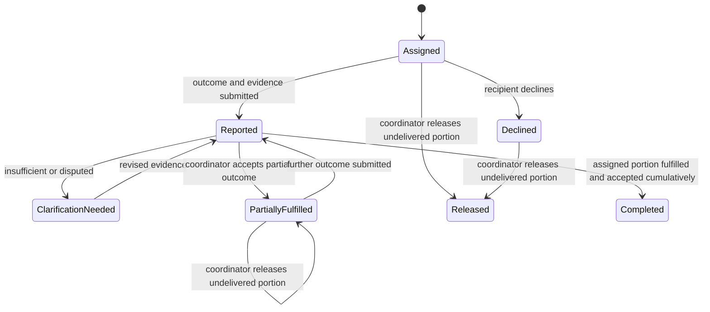
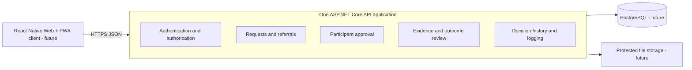

# Helping Hands system models

Status: supporting models for the [SRS](SRS.md). The Phase 1 roadmap takes priority over earlier delivery sequencing. Models describe target behavior, not proof of implementation; see the [capability assessment](SRS.md#appendix-phase-1-implementation-baseline-and-verification). State labels are proposed analysis states, not a final API contract. Mermaid diagrams are editable text; the proposed relationships and physical mappings are explained in [database design](database-design.md).

The [conceptual EER](diagrams/conceptual-eer.drawio) and [relational schema](diagrams/relational-schema.drawio) show the planned Phase 1 design on one canvas each. The physical mapping, fields and cardinalities remain proposals; see [database design](database-design.md) for rules and open decisions. The earlier full-product proposal is [archived](archive/database-proposal/).

The [P1-09 signup sequence](diagrams/registration-sequence.drawio) shows the current beneficiary and charity account flows. Merged PR #82 adds the two routes and seeds the `Beneficiary` role. The diagram distinguishes account/profile creation from later login and coordinator approval.

## System context



## Use case overview



## Activity: registration and approval



Beneficiaries use a separate signup route that creates an account and linked beneficiary profile. Charity signup creates a pending application; it does not approve or activate the charity. The coordinator reviews charities in Phase 1 and individual contributors in the later full-app scope. Administration of accounts is not evidence of beneficiary verification. These signup routes are target behavior, not current implementation.

## Activity: review, referral and follow-up

This full-product view includes release, dispute and unresolved closure paths planned after Phase 1. The demo covers initial split allocations, acceptance and explicit closure when all needs are fulfilled; the exact mapping of separately tracked needs is still to be designed.



If work stops with unmet need, the coordinator may close the request unresolved with a reason. A partial outcome cannot itself complete an entire referral. A released undelivered portion is available for another referral; the historical referral does not become fulfilled merely because it was released.

The proposed late-dispute handling also applies after an outcome has been accepted: a recorded disagreement is linked to the affected outcome, or to the request if the specific outcome is unclear; the affected request is flagged and its allocation is frozen pending coordinator resolution. A disputed child prevents its split ancestors from being displayed as completed. An audited correction preserves previous decisions and recomputes balances and ancestor outcomes. See the SRS and database design for the proposed rules and their test scenarios.

## Sequence: concurrent assignment (proposed)

```mermaid
sequenceDiagram
 actor C as Coordinator
 participant API as API
 participant DB as PostgreSQL
 C->>API: Assign quantity to approved recipient
 API->>DB: Begin transaction; lock request allocation
 API->>DB: Read need, accepted fulfillment and active assignments
 DB-->>API: Current totals
 alt Quantity is available
 API->>DB: Record referral and decision; commit
 API-->>C: Assignment recorded
 else Exceeds unassigned need or stale state
 API->>DB: Roll back
 API-->>C: Conflict; refresh current totals
 end
```

## Sequence: evidence review and partial delivery

```mermaid
sequenceDiagram
 actor P as Referral recipient
 actor C as Coordinator
 participant API as API
 participant Files as Protected evidence storage
 participant DB as PostgreSQL
 P->>API: Submit reported portion and evidence
 API->>Files: Validate and store protected file
 API->>DB: Record outcome and evidence metadata
 C->>API: Review outcome
 alt Clarification or dispute
 API->>DB: Record unresolved review and reason
 else Accept partial
 API->>DB: Record accepted quantity and partial status
 API-->>C: Referral incomplete; rest remains assigned until released
 else Accept report completing the assigned portion cumulatively
 API->>DB: Record accepted outcome and complete referral
 end
```

File/database failures must not falsely mark an outcome complete; the design must handle cleanup and recovery of a file whose metadata operation fails. Evidence review records a judgment, not independent proof.

## Conceptual domain / EER overview

The [Phase 1 conceptual model](diagrams/conceptual-eer.drawio) is the single database-domain overview. It depicts beneficiary requests and needs, charity approval and capacity, versioned standards, referral portions, reports, evidence, review and closure. It is a proposal; see [database design](database-design.md) for constraints and unresolved mappings.

## Request state model



Linked requests retain their relationship to the original. Under the proposed database design, a split parent is not allocatable: its children carry the distinct needs, and its displayed outcome is derived from their outcomes without counting the parent need again. Its status is completed only if all required child needs are fulfilled and accepted; it can be closed unresolved with a reason if work stops with unmet child need. These are proposed model details, not extra BRD decisions.

## Referral state model

This is a combined conceptual lifecycle: `Reported` and `ClarificationNeeded` describe outcome review, while the separate database proposal keeps those states on Outcome rather than Referral. Declined assignments retain their unresolved amount until explicitly released. The physical statuses and release history are specified in the database design.



Released and declined referrals remain historical records; release does not mean fulfillment. After partial fulfillment, the referral remains historically partially fulfilled even when its entire undelivered balance is released; its released balance is no longer assigned, and the history records the release. Partial acceptance does not complete the referral. The aggregate request can remain open while its unresolved need is assigned or unassigned.

## Monolithic component design



API source includes business workflow and dependency integrations; the client and complete Phase 1 workflow remain planned. See [architecture and compatibility](architecture.md) and the [capability assessment](SRS.md#appendix-phase-1-implementation-baseline-and-verification) for verification limits.
