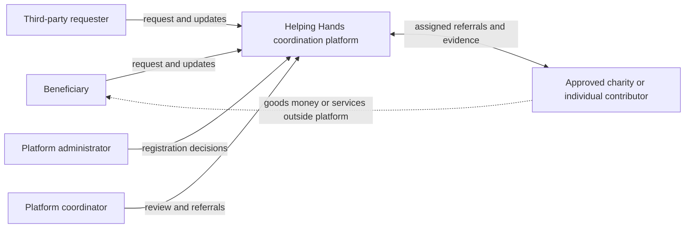
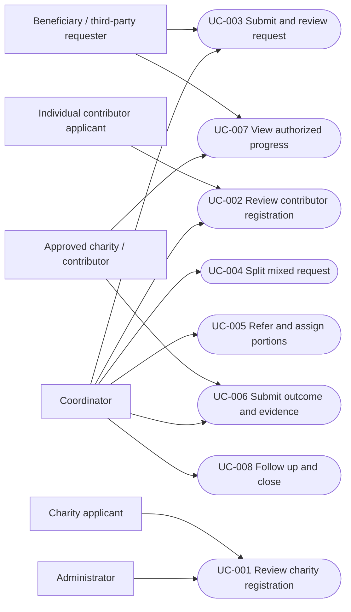
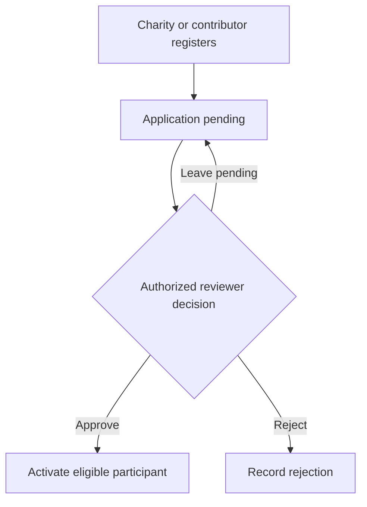
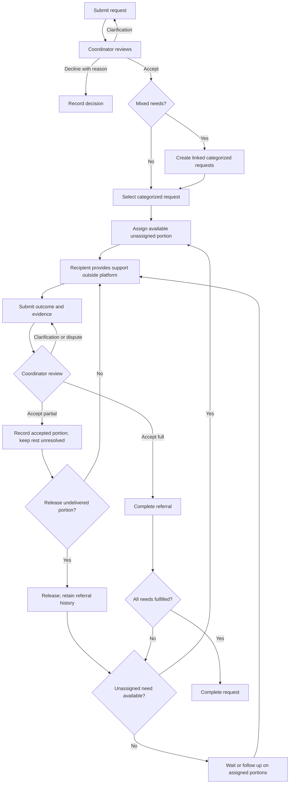
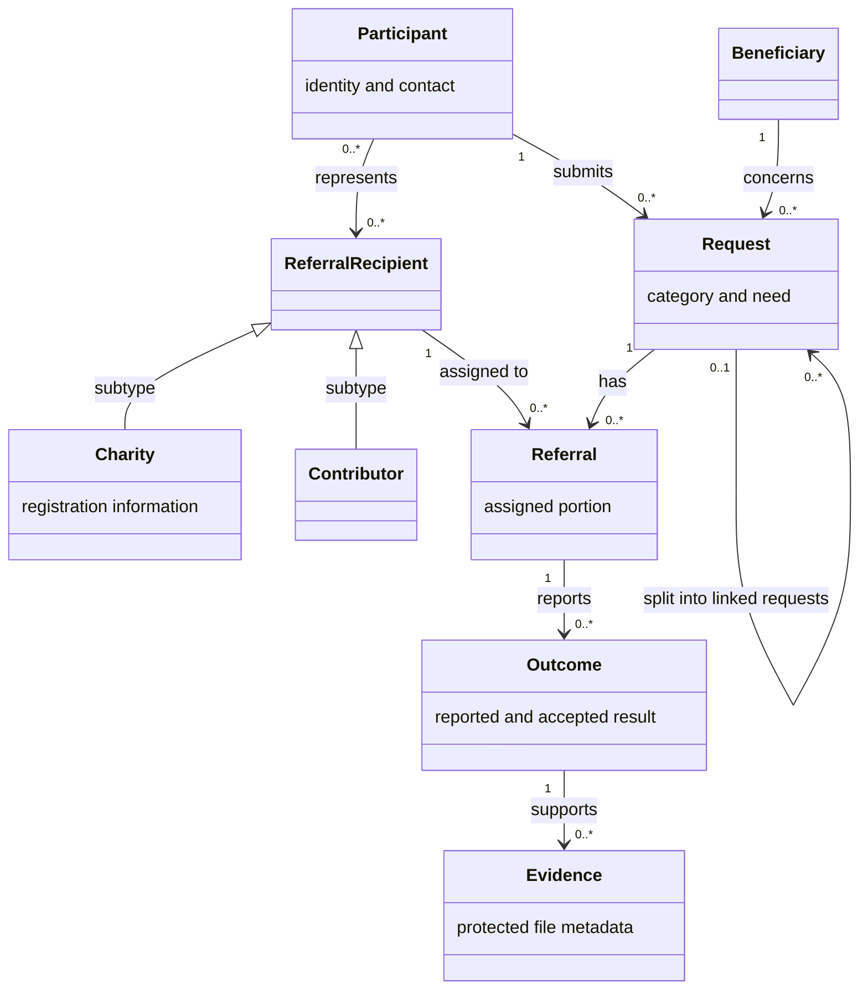
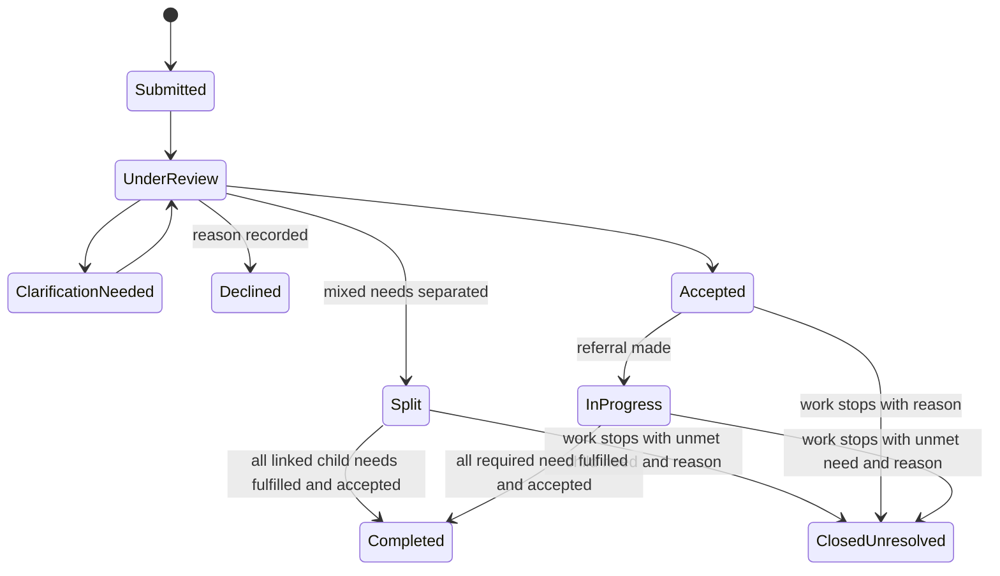
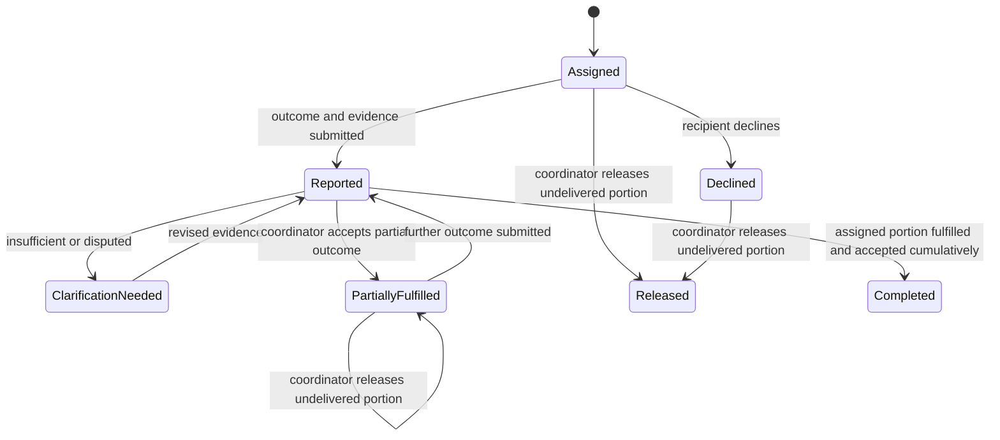
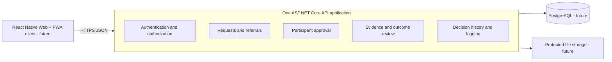

# Helping Hands system models

Status: supporting models for the finalized [SRS](SRS.md), not implemented. BRD 1.3 remains the business authority. State labels below are proposed analysis states, not a final API contract. Mermaid diagrams are editable text; the EER specialization constraints and physical mappings are explained in [database design](database-design.md).

Editable draw.io files: [conceptual EER](diagrams/conceptual-eer.drawio) and [relational schema](diagrams/relational-schema.drawio). Their XML and connectors were checked, but their layout has not been visually verified in draw.io.

## System context



## Use case overview



## Activity: registration and approval



Administrator reviews charities; coordinator reviews individual contributors. Administration of accounts is not evidence of beneficiary verification.

## Activity: review, referral and follow-up



If work stops with unmet need, the coordinator may close the request unresolved with a reason. A partial outcome cannot itself complete an entire referral. A released undelivered portion is available for another referral; the historical referral does not become fulfilled merely because it was released.

The proposed late-dispute handling also applies after an outcome has been accepted: a recorded disagreement is linked to the affected outcome, or to the request if the specific outcome is unclear; the affected request is flagged and its allocation is frozen pending coordinator resolution. A disputed child prevents its split ancestors from being displayed as completed. An audited correction preserves previous decisions and recomputes balances and ancestor outcomes. See the SRS and database design for the proposed rules and their test scenarios.

## Sequence: concurrent assignment (proposed)

```mermaid
sequenceDiagram
 actor C as Coordinator
 participant API as API
 participant DB as PostgreSQL
 C->>API: Assign quantity to approved recipient
 API->>DB: Begin transaction; lock request allocation
 API->>DB: Read need, accepted fulfillment and active assignments
 DB-->>API: Current totals
 alt Quantity is available
 API->>DB: Record referral and decision; commit
 API-->>C: Assignment recorded
 else Exceeds unassigned need or stale state
 API->>DB: Roll back
 API-->>C: Conflict; refresh current totals
 end
```

## Sequence: evidence review and partial delivery

```mermaid
sequenceDiagram
 actor P as Referral recipient
 actor C as Coordinator
 participant API as API
 participant Files as Protected evidence storage
 participant DB as PostgreSQL
 P->>API: Submit reported portion and evidence
 API->>Files: Validate and store protected file
 API->>DB: Record outcome and evidence metadata
 C->>API: Review outcome
 alt Clarification or dispute
 API->>DB: Record unresolved review and reason
 else Accept partial
 API->>DB: Record accepted quantity and partial status
 API-->>C: Referral incomplete; rest remains assigned until released
 else Accept report completing the assigned portion cumulatively
 API->>DB: Record accepted outcome and complete referral
 end
```

File/database failures must not falsely mark an outcome complete; the design must handle cleanup and recovery of a file whose metadata operation fails. Evidence review records a judgment, not independent proof.

## Conceptual domain / EER overview



The proposed referral-recipient specialization comprises charity and individual contributor; it is disjoint for a particular recipient profile and total for a referral target. A person can separately participate in other roles. Other participants in the conceptual diagram are not required to be referral recipients. Physical integrity and the mapping of this conceptual distinction are in [database design](database-design.md). Evidence may be collected in multiple attachments. Submitted evidence alone does not establish completion.

## Request state model



Linked requests retain their relationship to the original. Under the proposed database design, a split parent is not allocatable: its children carry the distinct needs, and its displayed outcome is derived from their outcomes without counting the parent need again. Its status is completed only if all required child needs are fulfilled and accepted; it can be closed unresolved with a reason if work stops with unmet child need. These are proposed model details, not extra BRD decisions.

## Referral state model

This is a combined conceptual lifecycle: `Reported` and `ClarificationNeeded` describe outcome review, while the separate database proposal keeps those states on Outcome rather than Referral. Declined assignments retain their unresolved amount until explicitly released. The physical statuses and release history are specified in the database design.



Released and declined referrals remain historical records; release does not mean fulfillment. After partial fulfillment, the referral remains historically partially fulfilled even when its entire undelivered balance is released; its released balance is no longer assigned, and the history records the release. Partial acceptance does not complete the referral. The aggregate request can remain open while its unresolved need is assigned or unassigned.

## Monolithic component design



The current scaffold has only `/health`; none of these business components or external dependencies is implemented. See [architecture and compatibility](architecture.md).
